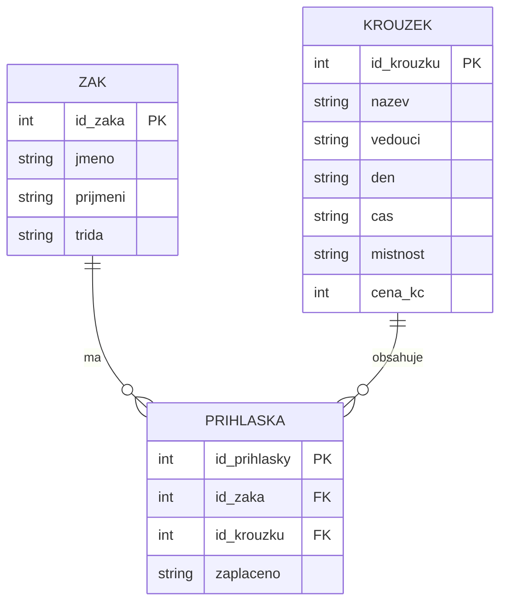

SP1 kroužky
10

nemá zarovnané 
sloupce mezera mezi IT 2 
nema dostatecne velke sloupce


zaci: PK id_zaka
krouzky: PK id_krouzku
prihlasky: PK id_prihlasky, FK id_zaka → zaci, FK id_krouzku → krouzky



```sql
SELECT nazev, cena
FROM krouzky
WHERE cena > 500;
```